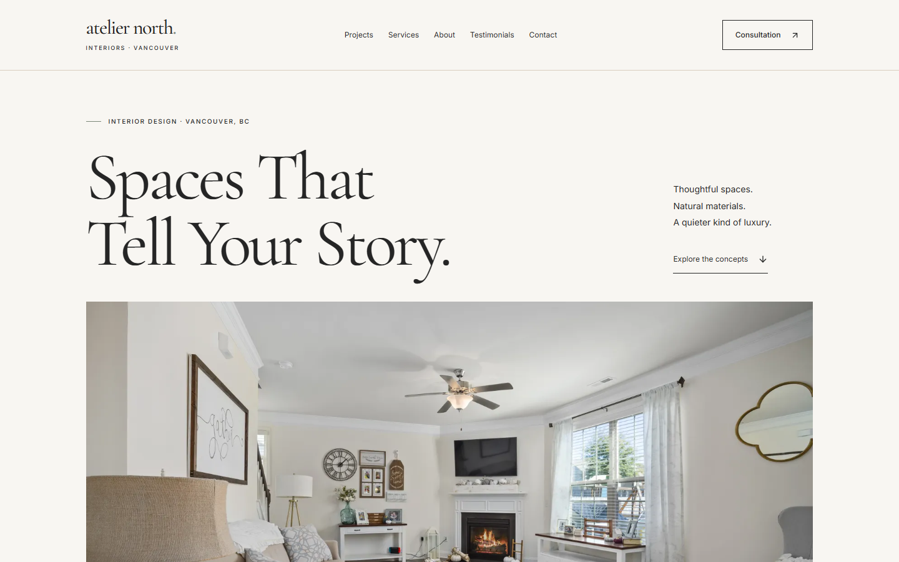
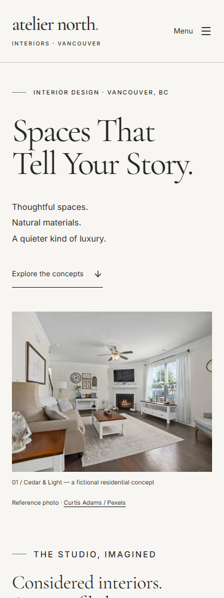

# Atelier North Interiors

A fictional Vancouver interior design studio portfolio demonstration built with React, Vite and JavaScript JSX.

**Spaces That Tell Your Story.**

[Live Website](https://atelier-north-interiors.vercel.app) · [GitHub Repository](https://github.com/awaljanhematyar/atelier-north-interiors)

> The studio, concept projects and testimonial examples are fictional. Photography is illustrative; forms do not send messages, store personal details or reserve appointments. Public indexing remains disabled.





More live captures: [desktop projects](screenshots/desktop-projects.png), [mobile projects](screenshots/mobile-projects.png), [project details](screenshots/desktop-project-details.png). These are actual browser captures, not generated mockups.

[Watch the 36.56-second live-site walkthrough](walkthrough/atelier-north-interiors.webm). Also included in the [personal portfolio](https://hematyar-professional-portfolio.vercel.app/projects/atelier-north-interiors).

## Features

- Twelve fictional concept studies across Residential, Commercial, Hospitality and Renovations.
- Category filtering with URL/history support, dynamic details, related concepts and previous/next navigation.
- Keyboard-accessible reference gallery and independently expandable service FAQs.
- Validated local-only contact and consultation demonstrations using Vancouver calendar dates.
- Responsive editorial layouts, local fonts, responsive photography, reduced motion and visible keyboard focus.
- Lazy page modules, chunk-failure recovery and route-specific build-time HTML metadata.
- Nineteen valid production routes, custom noindex 404s, actual-origin canonicals/social URLs and a generated sitemap.

## Technology stack

React 19, Vite 8, JavaScript JSX, Tailwind CSS v4, React Router DOM and Lucide React. Verification uses Vitest, React Testing Library, jest-dom, jsdom and ESLint.

## Requirements

Node.js 24.16+ within the Node 24 LTS line and npm 11. Exact installed package versions are recorded in package-lock.json. Use the same runtime locally and in future hosting settings.

## Installation

```sh
git clone https://github.com/awaljanhematyar/atelier-north-interiors.git
cd atelier-north-interiors
npm ci
```

## Development commands

```sh
npm ci
npm run dev
npm run build
npm run preview
npm run lint
npm test
npm run test:watch
```

On Windows, if command resolution selects an inaccessible system shim, use the actual Node installation in PATH and invoke npm.cmd. No secrets or environment variables are required.

## Project structure

- `src/components/layout`, `ui`, `features`: shared shell, primitives and feature components.
- `src/pages`: Home, Projects, dynamic Project Details, Services, About, Testimonials, shared Contact/Consultation layout and custom not-found page.
- `src/data`: twelve project records, category labels, studio/services/process/FAQ/testimonial copy and navigation.
- `src/assets`, `public`: bundled and directly served assets.
- `src/hooks`, `src/utils`: document metadata, responsive image candidates, portfolio helpers and demo validation/date utilities.
- `scripts/seo-build.js`: Vite plugin emitting route-specific static head tags, robots and optional sitemap; no production server or new framework.
- `src/test`: Vitest setup; tests live beside their subjects.
- `src/App.jsx`, `main.jsx`, `index.css`, `content.css`, `interactions.css`: routes, React entry, preserved theme/shell, editorial styles and interaction states.

Empty directories contain .gitkeep files to preserve the approved structure in version control. The project is tracked on `main` in the existing public [GitHub repository](https://github.com/awaljanhematyar/atelier-north-interiors).

## Tooling

Tailwind uses the official @tailwindcss/vite plugin and CSS-first theme tokens. ESLint checks JavaScript, JSX, React Hooks and Fast Refresh. Vitest uses React Testing Library, jest-dom and jsdom; existing assertions remain, with asynchronous waits for lazy pages plus metadata, build-output and asset regression coverage. Two thread workers avoid observed Windows fork-startup failures while retaining per-file isolation; asynchronous waits cover lazy imports and metadata effects. Dialog methods are stubbed only in jsdom; actual browsers verify modality and background isolation. No application dependencies were added for Phase 5. Temporary Lighthouse/browser tooling is isolated in ignored tmp/.

## Visual system and navigation

The exact ivory, charcoal, taupe, beige and sage palette is defined in `src/index.css`, alongside spacing, responsive gutters, an 80rem container and fluid heading sizes. Cormorant Garamond and Inter are locally hosted with font-display: swap; font provenance and SIL licenses are in `public/fonts`. English Latin subsets are included. Taupe and sage serve as decorative accents; text uses charcoal against ivory/beige or the reverse.

The desktop header is sticky from 1024px. Smaller layouts use an inline navigation disclosure with native link/button keyboard behavior, expanded state, Escape dismissal and focus return. It closes on navigation, focus leaving the header or a breakpoint change. The menu is not a modal dialog and does not trap focus. Route changes focus the main landmark; the skip link bypasses navigation. Motion is limited to CSS state transitions and disabled for reduced-motion preference.

## Approved scope and demo boundaries

Core routes: `/`, `/projects`, `/projects/:slug`, `/services`, `/about`, `/testimonials`, `/consultation`, `/contact` and a catch-all 404. Unknown project slugs show the custom not-found page. The twelve project records and image credits are unchanged.

Category buttons show accurate counts and store only the selected category in a query parameter, supporting direct links and browser history without reloads. Filter changes preserve keyboard focus and scroll. All Projects is the default; unknown URL categories safely display all concepts. Project navigation follows data order and does not wrap at the first/last concept. Related previews prioritize the same category, then fill from the remaining source order.

Gallery triggers open a native modal dialog. Previous/next images wrap; Left/Right arrows browse, Escape/Close dismiss, Tab stays in the dialog and focus returns to the opener. Background interaction and scrolling are blocked while open. Missing/failed images retain an accessible fallback. Service FAQs use independently controlled buttons with expanded states and associated answer IDs.

Contact and Consultation are controlled local React demos. Required fields, trimmed empty values, basic email format, category and acknowledgment are validated; Consultation additionally validates a real calendar date, no dates before today in Vancouver, and an allowed time window. Errors retain entries, announce feedback and focus the first invalid field. Completion is immediate, guarded against duplicates, and clears entered data. Start again/Clear form resets state and restores focus to the name field.

Name, email and message/brief limits are 120, 254 and 5,000 characters respectively, enforced by both native controls and validation. Missing project images, credits, scope and materials have safe rendering paths. Gallery selection remains valid if its image list shrinks.

No form fetch, email, calendar, backend, storage write or real reservation occurs. Enter sample values only: input exists temporarily in component memory until completion, reset or navigation. Consultation confirmation explicitly says: “This is a demo. No appointment has been booked.” Contact confirmation says no message has been delivered. Contact information uses a reserved `.example` address and no real office location.

Dates use `Intl.DateTimeFormat` with `America/Vancouver`, not the device's local calendar or a hard-coded offset. Keep browser/runtime timezone data current. B.C. adopted permanent daylight time in 2026; the earlier seasonal-time copy was corrected after checking [the official provincial notice](https://news.gov.bc.ca/releases/2026AG0013-000209). This demo does not model appointment duration, availability or a scheduling service.

Testimonials are explicitly fictional examples at page and quotation level, without real identities, ratings or verified-review claims. No backend, database, payments or authentication is included.

The five specification documents remain unchanged. memory.md records verified work and approved review decisions. HTML remains intentionally noindex until the publication/indexing policy is reviewed.

## Reference photography

See [IMAGE_CREDITS.md](IMAGE_CREDITS.md) for twelve original Pexels photo pages, photographers, licence links, verification date and download recipe. Twenty-four local WebP variants (640/1600px) use responsive srcSet/sizes, lazy loading for supporting images and accessible fallback text. Photographer credits are also shown beside imagery. Photos are illustrative references assembled from separate spaces, not completed work or real project documentation by Atelier North. No runtime external image request is needed.

One additional 960px portrait variant addresses a measured mobile image-delivery issue. Its provenance and byte savings are recorded in [ASSET_OPTIMIZATION.md](ASSET_OPTIMIZATION.md). Original assets and IMAGE_CREDITS.md remain unchanged. Fonts and critical route hero images have matching local preload hints; supporting images stay lazy. Home renders eagerly; other core pages load on demand with an announced loading state and a reload recovery link if a page chunk fails.

## Metadata and publication configuration

Every valid route, including all twelve details, has a unique title/description and accurate Open Graph/Twitter card metadata. The Vite build writes nineteen HTML documents with route-specific **head tags** and the same client-rendered React shell. Raw HTML responses can expose sharing metadata without executing JavaScript. Page bodies still require JavaScript; this is not server rendering or full page prerendering. No business/review structured data is emitted.

Build-time settings are optional public configuration, never secrets:

| Setting | Default | Purpose |
|---|---|---|
| `SITE_URL` | Unset | Actual HTTPS production origin, without a path, credentials, query or fragment. Enables absolute canonical/social URLs and sitemap generation. |
| `INDEX_SITE` | `false` | Only the exact value `true`, together with a valid origin, permits indexing. Keep disabled on local and preview builds. |

No hostname is guessed from a preview deployment. Without SITE_URL, canonical/og:url tags and sitemap.xml are omitted; sharing image paths remain local/relative. robots.txt is generated with Disallow: / and pages remain noindex, nofollow. With the real origin, the generated sitemap includes exactly seven core paths plus twelve project paths, excluding filters, invalid slugs and 404s. Indexing still requires the explicit flag. Never submit a fixture/test hostname to search engines.

The preview middleware serves the generated route head directly and returns a noindex 404 for unknown paths. Vercel configuration maps valid nested paths to their generated documents, preserves filesystem assets and leaves unknown routes to the generated 404.html, following [Vercel's static 404 guidance](https://vercel.com/kb/guide/custom-404-page). Canonicals normalize query variants to the base route. Live anonymous HTTP checks verified all nineteen route heads, the sitemap, four unknown-route noindex 404s and cache/security headers. Hashed /assets files receive immutable caching; unversioned photos/fonts retain normal platform caching.

Production canonicals and social-image URLs use https://atelier-north-interiors.vercel.app; their anonymous HTML/image responses were verified. Existing licensed local WebP references have explicit illustrative-photo alt text. Head tags are available without JavaScript, but actual social-platform rendering, caching and image-format support have not been verified through platform validators. Lab LCP/CLS and observed interaction timings are distinct from real-user field INP; see [the INP measurement guidance](https://web.dev/articles/inp).

## Customization and deployment

Follow PRD.md, architecture.md, design.md, rules.md and phases.doc.md. Reuse the components in `src/components/ui` and the theme tokens when adding content. Check image licensing before adding photography.

Production is deployed to Vercel with the Vite framework, `npm ci`, `npm run build`, `dist` output and Node 24.x. The existing GitHub repository is connected for `main` deployments. [Vercel documents Node 24 support](https://vercel.com/docs/functions/runtimes/node-js/node-js-versions).

Production Config values are `SITE_URL=https://atelier-north-interiors.vercel.app` and `INDEX_SITE=false`. Neither is a secret. Keep preview deployments noindex and do not enable public indexing without the owner's explicit approval. A future actual-domain change requires updating SITE_URL and rebuilding.

After subsequent deployments, verify direct route refresh, each route's raw head, canonical/social images, robots/sitemap, custom 404 HTTP status and caching/security headers. Do not restore a blanket rewrite to the home document, which would hide route-specific metadata and unknown-route status. `.vercelignore` keeps temporary tools/checkouts, local credentials, dependencies, builds and documentation screenshot/video sources out of CLI uploads.

Real enquiries or scheduling require a separately approved service integration, privacy review and server-side validation. Do not place secrets in client code or VITE-prefixed variables.

## Verification and limitations

Phase 6 live production checks verified nineteen valid route responses/canonicals, nineteen sitemap entries, four noindex 404s, twenty-five WebPs, two fonts, favicon and cache/security headers. Chromium passed 197 live responsive/interaction states at eight widths, including enlarged text, menus, filters, gallery, FAQs, project links and both demo forms, with no unexpected console/page/resource errors or external requests. The actual screenshots above were reviewed at their native viewport sizes. Live WebKit also passed sixteen navigation/text-size states and both form-error states at 320px/200% text. Final Phase 6 build, lint and 125 tests across nine files passed; npm audit reported zero known vulnerabilities. Test discovery is scoped to src to exclude temporary tooling and related checkouts.

Phase 5 verification includes a successful production build, lint, 125 automated tests and an npm audit reporting zero known vulnerabilities. Actual Chromium, Firefox and WebKit each passed 197 responsive/interaction states at eight widths from 320–1920px, including 200% root text sizing, landscape and local production routing. A further 30 focused browser states checked visible labels against accessible names. All nineteen route heads, four unknown-route noindex 404 responses, twenty-five WebP files, local fonts, favicon and nested refresh/recovery were verified. WebKit's enlarged native select text wraps without clipping content or focus indicators.

See memory.md for exact commands, Lighthouse scores, lab measurements and host warnings. These are local observations, not field Core Web Vitals or a guarantee of performance on every device. Indexing remains deliberately blocked until the real domain and publication policy are approved. Some image-delivery opportunities remain below the fold.

Archived Phase 5 Lighthouse 13.5.0 local production-preview scores (not measurements of the live deployment):

| Profile | Performance | Accessibility | Best Practices | SEO |
|---|---:|---:|---:|---:|
| Mobile | 94 | 100 | 100 | 66 |
| Desktop | 100 | 100 | 100 | 66 |

The only weighted SEO failure is the intentional indexing block. Mobile LCP was 2.763s, above the 2.5s goal, with a slow-host CPU warning; desktop LCP was 0.645s. CLS was 0.00048/0 respectively. These are measured limitations, not a claim that every performance target has been met.

WebKit is an actual engine check, not physical Safari/iOS verification. Its Windows default Tab behavior skips links; focus-exit dismissal and Escape from a focused navigation link were checked separately. NVDA, VoiceOver, TalkBack, native browser zoom and physical touch devices were not tested. Accessibility audit scores and semantic checks are not WCAG certification or screen-reader verification.

Real-user field performance and social-platform card rendering remain unverified. The source remains a client-rendered React application, with static head metadata rather than full body prerendering. See memory.md for the final deployment and portfolio handoff record.

## Licence and attribution

No repository-wide source-code licence has been specified. Photography provenance and Pexels licence links are in [IMAGE_CREDITS.md](IMAGE_CREDITS.md), with the additional responsive derivative documented in [ASSET_OPTIMIZATION.md](ASSET_OPTIMIZATION.md). Font provenance and SIL licence files are included under `public/fonts`. Screenshots and the walkthrough show the real demo interface with its incorporated reference photography; they do not represent completed client commissions.
